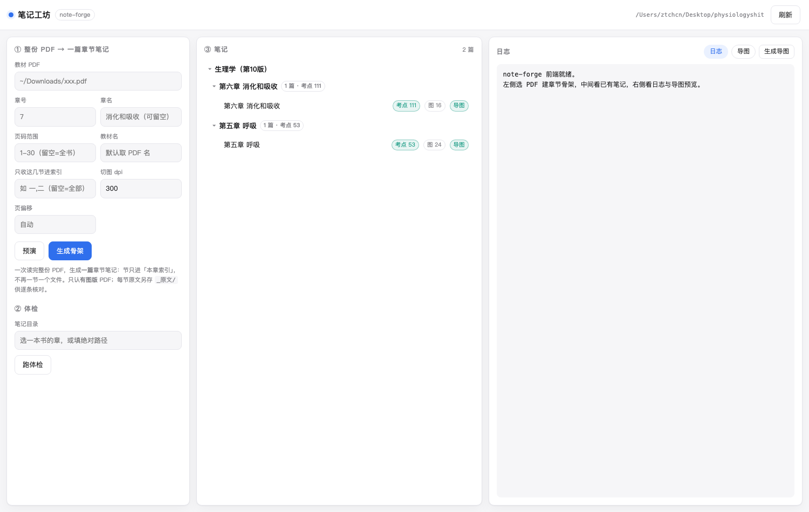
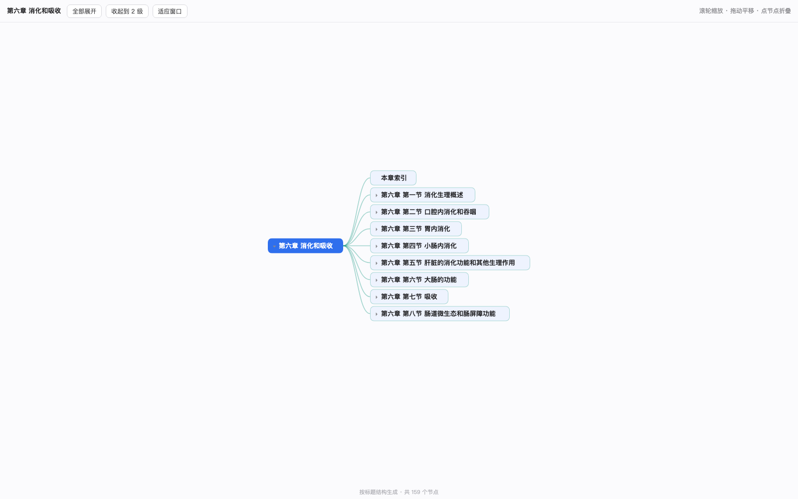

# dsh-note-forge

把**有图版**教材 PDF 变成 Obsidian 里的考点笔记。装在 [DeepSeek Harness](https://github.com/deepseek-ai/dsh)（dsh）里，提供 `noteforge_*` 工具、一个 `note-forge` skill，以及自带的本地 Web 前端。

> A DeepSeek Harness plugin that turns figure‑bearing textbook PDFs into Obsidian exam‑point notes: figures cut from captions at 300 dpi, **one note per chapter** (sections become an in‑note index), plus a local web UI and dependency‑free interactive mind maps.




## 它做什么

一份 PDF → **一篇章节笔记**，节退居为「本章索引」，不再一节一个文件。

| 工具 | 干什么 |
| --- | --- |
| `noteforge_prepare` | 读**整份** PDF：按「图N-x」题注 300 dpi 切全部插图、「第X节」只用来建**本章索引**、生成**一篇**笔记骨架 + `_原文/` 分节留档 |
| `noteforge_report` | 体检：考点数 / 待补占位 / 断图 / frontmatter 缺字段 |
| `noteforge_mindmap` | 出**零依赖单文件**交互导图（折叠 / 缩放 / 拖拽，双击离线可看） |
| `noteforge_ui` | 启动 / 停止本地前端（默认 `127.0.0.1:7788`） |

生成的笔记结构：

```
frontmatter（章 / 教材 / 页范围 / 图清单）
> 定位 callout（教材原文线，与按题号组织的旧笔记互补）
> 这一章在考什么
mermaid 骨架
## 本章索引            ← 表格：节 / 标题 / 教材页 / 图数 / 考点数，[[#第一节 …]] 可跳转
## 第X节 标题           ← 插图（教材原图 + 题注）
#### 考点：…            ← 一句话 / 机制 / 对比表 / 易错 / 补充 / 出处
## 速记卡
> 全章出处
```

## 安装

```bash
# 从本地目录装
dsh plugin --profile tauri add link:/path/to/dsh-note-forge

# 或直接从 GitHub 装
dsh plugin --profile tauri add github:<你的账号>/dsh-note-forge
```

装完**重启 dsh**（host 插件在启动时加载；改代码也要重启）。

配置在 `cordis.patch.yml`：`vaultPath` 指向你的 Obsidian vault（`~` 开头或绝对路径，缺省 `~/Desktop/physiologyshit`）。

## 依赖

- **Node.js** 22.19+ 或 24+
- **Python 3 + PyMuPDF**（切图用）。插件自己找解释器：`NOTEFORGE_PYTHON` → 工作区 `.venv-pdf/bin/python` → `python3`，逐个试 `import pymupdf`。

```bash
python3 -m venv .venv-pdf && ./.venv-pdf/bin/pip install pymupdf
```

## 用法

```js
noteforge_prepare { pdf: "~/Downloads/第六章.pdf", chapter: "6", title: "消化和吸收", dryRun: true }
noteforge_prepare { pdf: "~/Downloads/第六章.pdf", chapter: "6", title: "消化和吸收" }
noteforge_report  { dir: "插件整合笔记/生理学（第10版）/第六章 消化和吸收" }
noteforge_mindmap { note: "插件整合笔记/生理学（第10版）/第六章 消化和吸收/第六章 消化和吸收.md" }
```

默认落盘（`noteDir` / `figDir` 可覆盖，`sections` 只缩小索引范围）：

```
<vault>/插件整合笔记/<教材>/第N章/第N章 章名.md         ← 一章一篇
<vault>/插件整合笔记/<教材>/第N章/_原文/第X节 节名.txt   ← 逐条核对用
<vault>/插件整合笔记/<教材>/附件/生理图/图N-x 图题.png   ← 300 dpi，文件名即题注
```

## 前端

```bash
node ui/server.mjs            # → http://127.0.0.1:7788
node ui/server.mjs --port 7799
```

纯 Node + 原生 HTML/CSS/JS，零依赖、不打包、不需要 dsh 的 client bundle。三栏：左「整份 PDF → 章节骨架 + 体检」，中「书籍 / 章 / 笔记树（含考点数与图数）」，右「日志 / 导图内嵌预览」。只监听 `127.0.0.1`。

## 命令行直调

不经过 dsh 也能用：

```bash
python3 forge.py figures --pdf book.pdf --chapter 5 --out 附件/生理图 --pages 1-30 --dpi 300
python3 forge.py dump    --pdf book.pdf --pages 1-30
node lib/pipeline.js selftest
```

## 已知限制

- **只认有图版 PDF**：iOS/Quartz 导出的「去图版」正文完整、图全没了，切出来是空的。先 `dryRun` 看节识别，再抽一页确认有图。
- **题注与正文粘连会漏检**：工具会打印 `holes`（漏检图号），用 PyMuPDF `get_pixmap(clip=Rect(...))` 手工补切。
- **跨章 PDF**：一次读整份 PDF，但目前用 `chapter` 参数指定章号；整本书自动拆多章仍是 TODO。
- **改完插件代码要重启 dsh**：运行中的进程用旧模块。

## License

MIT

## 部署到服务器

插件本体是 Node 进程 + 一个 Python 切图脚本，服务器上需要 Node 22.19+/24+ 与 `python3 -m pip install pymupdf`。

```bash
# 服务器上
git clone https://github.com/<账号>/dsh-note-forge.git
cd dsh-note-forge
python3 -m venv .venv-pdf && ./.venv-pdf/bin/pip install pymupdf
node ui/server.mjs --host 0.0.0.0 --port 7788     # 默认只监听 127.0.0.1
dsh plugin --profile tauri add link:$(pwd)         # 需要在服务器上装 dsh 才有 noteforge_* 工具
```

`--host 0.0.0.0` 会把前端暴露到网络，前端没有鉴权，请配合防火墙 / 反向代理 Basic Auth / SSH 隧道使用：

```bash
ssh -N -L 7788:127.0.0.1:7788 用户名@服务器    # 更安全的做法：服务器仍只听 127.0.0.1
```

`vaultPath` 要指向服务器上的 Obsidian vault 路径（`cordis.patch.yml` 或环境变量 `NOTEFORGE_VAULT`）。
