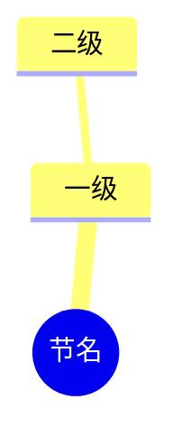

# note-forge —— 教材 → 考点笔记流水线

**语言**：跟随用户的会话语言；笔记正文用中文，术语用教材原词。

产出的笔记必须和 vault 里第五章那四篇**同构**（`插件整合笔记/生理学（第10版）/第五章 呼吸/`）。用户说过那套「已经很完美了」，任何"改进"都要先问，不要擅自改结构。

## 一、流程

1. **确认图源**：`forge.py` 只认有图版 PDF。纯文字版（Quartz 导出、扫描去图）切出来是空的，先用 `noteforge_prepare` 的 `dryRun: true` 看节识别，再抽一页验证图。
2. **跑准备**：`noteforge_prepare { pdf, chapter, title }` → 读整份 PDF：全部图切进 `<教材>/附件/生理图/`、每节原文进 `_原文/`、**只生成一篇**章节笔记（节进「本章索引」，不再一节一个文件）。
   - 默认落到 `<vault>/插件整合笔记/<source>/第N章/`；要放进 `第N章 <章名>/` 就显式传 `noteDir`。
   - 输出里若有「漏检图号」，说明题注与正文粘连，自己用 PyMuPDF `clip=Rect(...)` 补切（图5-21 就是这么补出来的）。
3. **逐节写**：在同一篇笔记里按「## 第X节」往下写，对着 `_原文/*.txt` 核对；写完一节就把该节的考点补齐，不要开新文件。
4. **体检**：`noteforge_report { dir }` —— 待补 0、断图 0、frontmatter 齐才算完。
5. **导图**：`noteforge_mindmap { note }` 出 markmap HTML（比 mermaid 好看，可折叠），链接放进笔记或索引。

## 二、笔记结构（照抄，不要自由发挥）

````
---
chapter: 5          # 章号，纯数字
section: "三"        # 汉字序号，带引号
title: 气体在血液中的运输
source: 生理学（第10版）
pages: 151-156      # 教材页码，不是 PDF 页序
created: 2026-10-25
tags: [生理学, 考点笔记, 第5章]
figures:            # 引用到的图，一行一个
  - 图5-14 氧解离曲线测定条件.png
---

# 第五章 第三节 气体在血液中的运输

> [!abstract] 这份笔记的定位
> 走**教材原文线**：按教材小节顺序把能出题的点拆开，图用教材原图。
> 按题号组织的旧笔记走**题目线**，两者互补。

> [!info] 这一节在考什么
> （三句话：为什么考 / 从哪个角度考 / 最容易混在哪）



## 一、（教材小标题）

#### 考点：（一句话命名，用教材术语）

**一句话**：。（必须能独立成句的结论，带数字）

**机制**：。（因果链：A→B→C，写成一段，不要 bullet 堆砌）

| 项目 | 数值/结论 |
| --- | --- |
|  |  |

> [!warning] 易错
> （学生最常错的判断，写成"不要以为……其实……"）

> [!note] 补充
> （教材之外的机制解释或临床联系，标 [补充]）

> [!quote] 出处
> 《生理学（第10版）》第 151–156 页。
````

每节收尾三块：

- `## 速记卡` —— 一张两列的表：`| 关键词 | 一句话 |`，覆盖本节全部考点。
- `## 本节图录` —— 图号 + 图题 + 一句话说明这张图能用来答什么题。
- 结尾 `> [!quote] 出处` 写清教材页码区间。

## 三、写法纪律

- **数字只用原文里的**。拿不准就回 `_原文/*.txt` 搜，禁止心算或凭印象。
- **原文自相矛盾时要标出来**，不要悄悄选一个：图5-14 的图注写 P50=28mmHg、正文写 26.5mmHg，笔记里写明两者的差异。
- **图的引用格式**：`![[图5-14 氧解离曲线测定条件.png|440]]`，图名必须和 `附件/生理图/` 里完全一致（含空格），否则 Obsidian 断图。
- **页码写教材页**，不是 PDF 页序；两者差一截（第五章 PDF p1≈教材 p.135）。
- **术语不改写**："霍尔丹效应"不写成"何尔登"，"肺换气"不写成"肺内气体交换"。
- 一个 `#### 考点` 只讲一个可考的结论；同一段教材出多个结论就拆多个考点。
- 不写"本节重点""本章小结"这类空话；每个 callout 都必须带信息量。

## 四、面板

需要用户填参数（PDF 路径 / 章号 / 教材名 / 页码范围 / 只生成哪几节）时，用 GenUI 面板（`render_ui` 或 ```dsh-ui 围栏）出表单，别用一大段文字问。面板回传 `[genui-action]` 后直接调 `noteforge_prepare`，再把结果用 `table` / `steps` 回填到面板。

## 五、不要做的事

- 不要在纯文字版 PDF 上硬切图然后声称"本节无图可用"——先说清是图源问题。
- 不要为了凑考点编造页码或数值。
- 不要重排已有笔记的章节顺序、不要改文件名（文件名是 `第<章>章 第<节>节 <节名>.md`，索引和合并版都靠它）。
- 不要自动覆盖已写好的笔记：`noteforge_prepare` 会重写骨架，对已有正文的目录先 `dryRun` 或换 `noteDir`。

## 前端

用户想自己动手时，先起本地 UI：`node ui/server.mjs`（或工具 `noteforge_ui`），打开 http://127.0.0.1:7788 —— 左栏建骨架/体检，中栏看笔记树，右栏看日志与导图预览。
